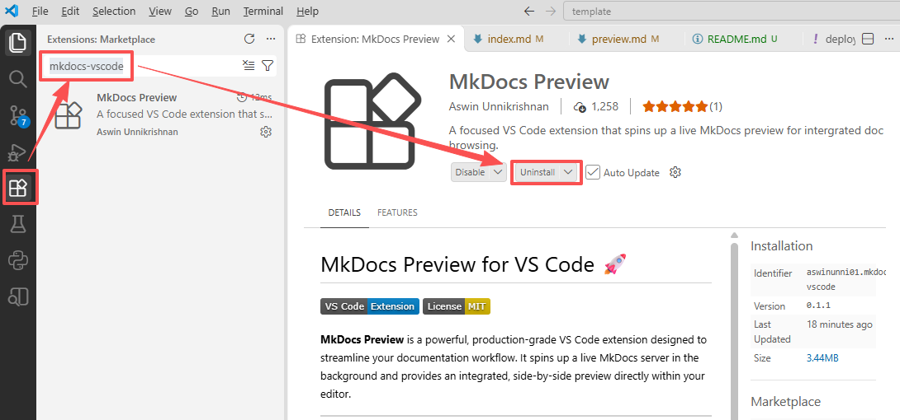
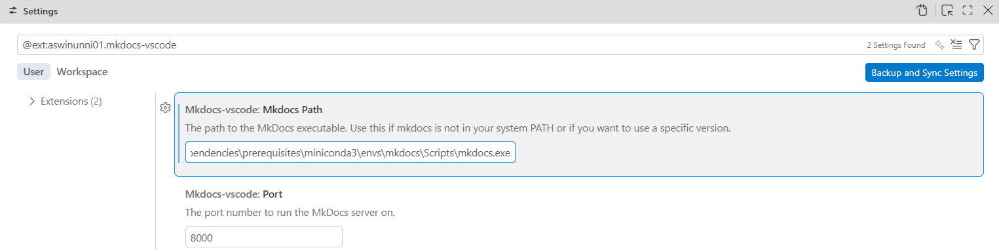
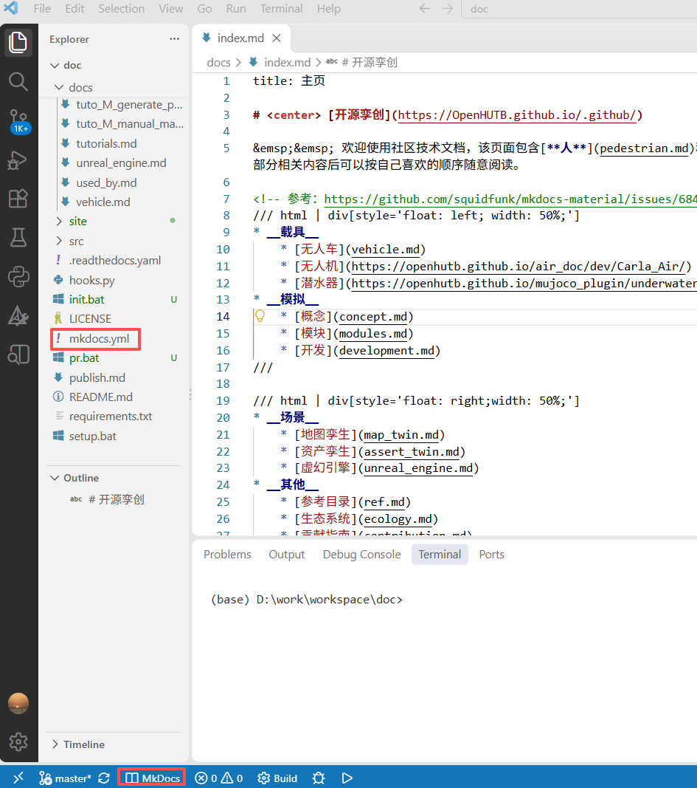
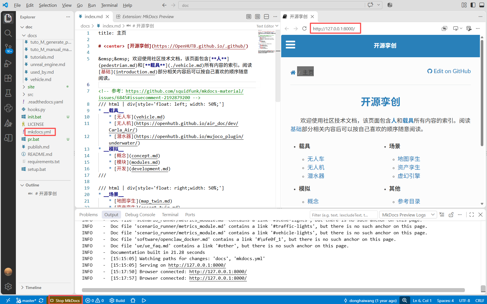

# 使用 VS Code 文档撰写时的实时预览

由于 OpenHUTB 社区的文档和默认的 Markdown 和 mkdocs 预览的文档有所区别，下面介绍社区文档撰写时的实时预览方法，以加快文档撰写的速度和质量（该方法同样适应于 mkdocs 文档的撰写）。

**1.**在 VS Code 的右侧的 Extensions (Ctrl + Shift +X) 中搜索 `mkdocs-vscode` 插件并安装；




**2.**安装 Python 3.8+ 和相关的依赖
```shell
pip install hutb-doc
```

**3.**由于系统中默认的 mkdocs 命令可能不是 mkdocs 命令所在的 Python 虚拟环境，点击上图中的齿轮图片并选中下拉菜单中的 `Settings`，进行 mkdocs 命令绝对路径的设置




**4.**打开包含 `mkdocs.yml` 文件的工作空间。

**5.**左下角的状态栏中找到并点击 Mkdocs 按钮。



**6.**等待服务启动，刷新弹出的预览框，即可看到文档的最终效果。每次修改后，都可以在预览框中看到修改后的效果。点击`Stop MkDocs`即可停止服务器。




